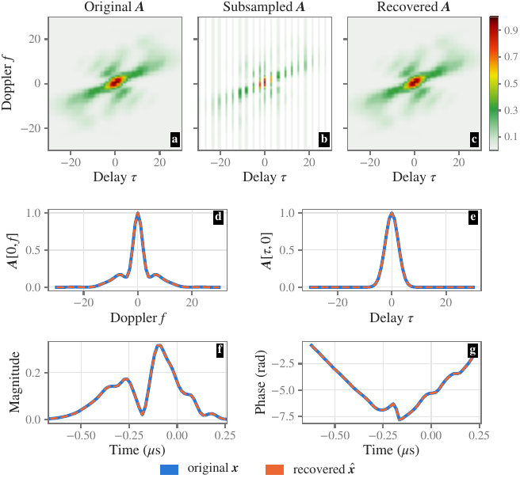
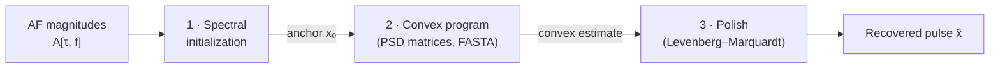
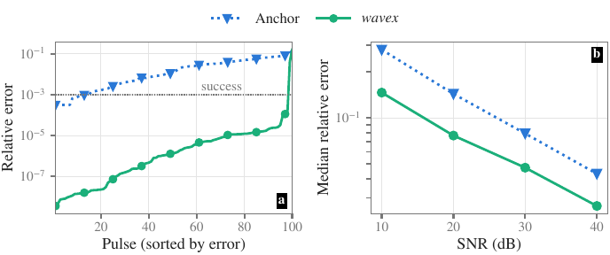

<div align="center">

# *wavex*

**Recover a radar waveform from its narrow-band ambiguity function by convex optimization.**

[Overview](#overview) · [Model](#problem-and-lifted-model) · [Algorithm](#algorithm) · [Install](#install-and-use) · [Layout](#layout)

</div>

<p align="center">
  
</p>
<p align="center"><sub>
Recovery from an incomplete AF in which every third delay is kept (66% of the samples removed).
(a)–(c) original, subsampled and recovered AFs, normalized to a unit peak;
(d), (e) zero-delay and zero-Doppler slices; (f), (g) magnitude and phase of the recovered pulse (red) and the true pulse (blue), aligned over the trivial ambiguities.
</sub></p>

## Overview

Given only the magnitude of the discrete narrow-band ambiguity function (AF) of a
pulse $x \in \mathbb{C}^N$, *wavex* reconstructs the pulse, magnitude *and* phase, up to the
AF's trivial ambiguities. The numerical building blocks (operators, penalties and
solvers) come from [invexapi](https://github.com/samuelpinilla/invexapi).



## Problem and lifted model

The AF samples are

$$
A[\tau, f] = \left| \sum_n x[n]\,\overline{(\Phi_\tau x)[n]}\, e^{-2\pi i n f/N} \right|^{2},
\qquad \Phi_\tau = F^{H}\,\mathrm{diag}\big(e^{-2\pi i l \tau/N}\big)\,F,
$$

with $F$ the DFT and the frequency index centred, $l \in [-N/2, N/2)$. The delay
$\Phi_\tau$ is a Fourier-domain phase ramp. On integer grids it is the cyclic shift
$(\Phi_\tau x)[n] = x[n-\tau]$, and it also allows fractional delays and Doppler.

The AF is quartic in $x$, but lifting $x$ to $X = x x^{H}$ makes every sample the
squared magnitude of a linear measurement:

$$
A[\tau, f] = \big|\mathrm{Tr}(B_{\tau,f} X)\big|^2,
\qquad B_{\tau,f} = \Phi_\tau^{H}\,\mathrm{diag}\big(e^{-2\pi i n f/N}\big).
$$

$\mathrm{Tr}(B_{\tau,f} X)$ is the Doppler transform of the diagonal of $X \Phi_\tau^{H}$, so the lifted
operator is matrix-free and costs $O(N^2 (T + K))$ for $T$ delays and $K$ Doppler bins. On
the full integer grid, $B^{H}B = N\,I$.

### Trivial ambiguities

The AF does not change under a global phase, a modulation $e^{ibn}$, a time shift
(fractional ones included) or the reflection $x[-n]$. A fractional modulation
leaves the cyclic AF unchanged only if its ramp wraps where the pulse is
negligible, so the distance reads $n$ on a window that wraps at the pulse's
weakest stretch. Errors are measured as $\mathrm{dist}(x, q)/\|x\|$, the distance minimized
over these trivial ambiguities.

### Band-limited pulses

The pulse is $B$-band-limited with $B \le N/2$: its spectrum vanishes outside $B$
contiguous DFT bins. This is the condition under which the AF determines almost
every pulse up to the trivial ambiguities. Modulation is a trivial ambiguity, so
only the band's width matters and *wavex* works in the centred band of $B = N/2$ bins:
$X = Q W Q^{H}$ with $Q$ the orthonormal in-band DFT columns and $W$ Hermitian, $B \times B$.

The band also removes the residue-class phases $x[n] \mapsto e^{i\varphi_{n \bmod L}} x[n]$, which
leave the AF unchanged when only the delays $0, L, 2L, \dots$ are measured and $L$
divides $N$: they mix copies of $x$ modulated by multiples of $N/L$ bins, which leave
the band. It also keeps decimated problems determined: an in-band $W$ has $B^2$ real
unknowns instead of $N^2$.

## Algorithm

### 1 · Spectral initialization

With $\mathcal{A}(W) = B(Q W Q^{H})$ the in-band lifted operator
and $b = \sqrt{A}$, from a random start $x = Qc$ the initialization repeats the
spectral step

$$
y = \mathcal{A}(c c^{H}), \qquad c \leftarrow \mathrm{lead}\big( c c^{H} + \mathcal{A}^{+}( b \odot \mathrm{sgn}(y) - y ) \big)
$$

where $\mathrm{lead}(S) = \sqrt{\lambda_1}\, v_1$ is the leading eigenpair and $\mathcal{A}^{+}$ is applied by a few
conjugate-gradient steps from zero (the minimum-norm Hermitian correction). On
the full grid $\mathcal{A}^{H}\mathcal{A} = N I$ and the step is the back-projection
$\mathrm{lead}(\mathcal{A}^{H}(b \odot \mathrm{sgn}(y)))$; on decimated grids the correction keeps the true pulse a
fixed point even where $\mathcal{A}$ has a null space.

Written as two maps on lifted matrices,

$$
P_M(X) = X + \mathcal{A}^{+}\big(b \odot \mathrm{sgn}(\mathcal{A}X) - \mathcal{A}X\big) \quad\text{(fit the magnitudes)},
$$

$$
P_S(X) = \mathrm{lead}(X)\,\mathrm{lead}(X)^{H} \quad\text{(best rank-one fit)},
$$

the plain step $X \leftarrow P_S(P_M(X))$ can stall at a fixed point away from the pulse.
The initialization therefore runs the relaxed averaged reflections

$$
X \leftarrow \tfrac{\beta}{2}\,(R_S R_M + I)X + (1-\beta)\,P_M(X),
\qquad R = 2P - I, \quad \beta = 0.9,
$$

from a single random start (300 steps); they keep the pulse a fixed point but
escape those stalls. The anchor $x_0$ is the leading factor of $P_S(P_M(X))$,
scaled to $\|x\| = A[0,0]^{1/4}$.

### 2 · Convex program

Starting from $W_0 = c_0 c_0^{H}$, $c_0 = Q^{H}x_0$ (after centring the
anchor's spectrum by an integer modulation), with $b = \sqrt{A}$, solve

$$
\min_{W \succeq 0}\ \tfrac12\,\big\| \,|\mathcal{A}(W)| + s - b \,\big\|^2 + \mu\,\mathrm{tr}(W)
$$

by FASTA (adaptive forward–backward splitting) in three rounds. On the PSD cone
the trace is the nuclear norm. Between rounds the slack is refreshed to
$s = \max(b - |\mathcal{A}(W)|,\, 0)$ and $\mu$ shrinks tenfold, starting from
$\mu = 10^{-2}\,\|\mathrm{eig}(\mathcal{A}^{H}b)\|_1$. The estimate is $Q\sqrt{\lambda_1}\,v_1$, from the leading eigenpair of $W$.

### 3 · Polish

Levenberg–Marquardt on the intensity misfit $A(x) - A$, started from
the convex estimate.

### Components

| Role | Object |
|---|---|
| Lifted AF $Z \mapsto \mathrm{Tr}(B_{\tau,f} Z)$ | `invexapi.operators.LiftedRadarAmbiguity` |
| Signal-domain AF $x \mapsto A[\tau, f]$ | `invexapi.operators.RadarAmbiguity` |
| Data fidelity with slack | `invexapi.SlackAmplitudeLeastSquares` |
| In-band lift $W \mapsto \mathrm{Tr}(B_{\tau,f} Q W Q^{H})$ | `wavex.BandLimitedLift` |
| Trace and PSD constraint | `invexapi.PSDTracePenalty(μ)` |
| Convex solver, polish | `invexapi.optim.FASTA`, `invexapi.optim.LevenbergMarquardt` |

## Accuracy

<p align="center">
  
</p>
<p align="center"><sub>
Relative error of the anchor and of *wavex*. (a) Sorted errors of the 100 pulses from the complete AF; the dotted line marks the success threshold $10^{-3}$.
(b) Median error over 20 pulses versus SNR on the complete AF.
</sub></p>

## Install and use

```bash
pip install -e ../invexapi      # or wherever invexapi lives
pip install -e .
python wavex/recover_pulse.py                   # pulse 3, complete AF
python wavex/recover_pulse.py --decimation 3    # keep every 3rd delay
python wavex/recover_pulse.py --bandwidth 128   # full space instead of the N/2 band
```

```python
from invexapi.operators import LiftedRadarAmbiguity
from wavex import align, load_pulse, spectral_init, wavex

x = load_pulse(2)                       # ground truth, for scoring only
op = LiftedRadarAmbiguity(len(x))       # all integer delays and Doppler bins
af = op.ambiguity(x)                    # the measurements

result = wavex(op, af, spectral_init(op, af))
print(align(x.numpy(), result.x.numpy()).relative_error)
```

`experiments/` reproduces the numerical comparisons (benchmark, incomplete and noisy
AFs, figures). `pytest` runs the tests.

## Layout

```
wavex/
  recover_pulse.py       command-line driver
  data/pulse_set.mat     benchmark pulses (100 x 128, complex)
  src/wavex/
    band.py              centred in-band lifted operator
    initialization.py    spectral initialization
    solver.py            convex program and polish
    distance.py          distance up to trivial ambiguities
    baseline.py          nonconvex baseline for comparison
    data.py, plotting.py
experiments/             benchmark, incomplete, noisy, plots
tests/test_wavex.py
assets/                  figures used in this README
```
